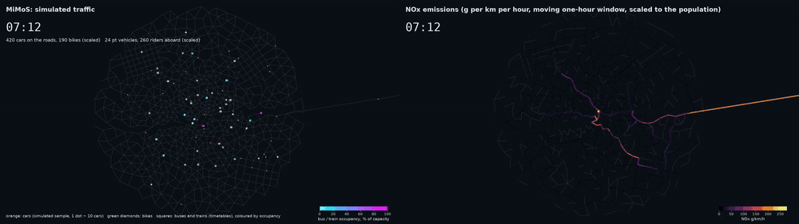
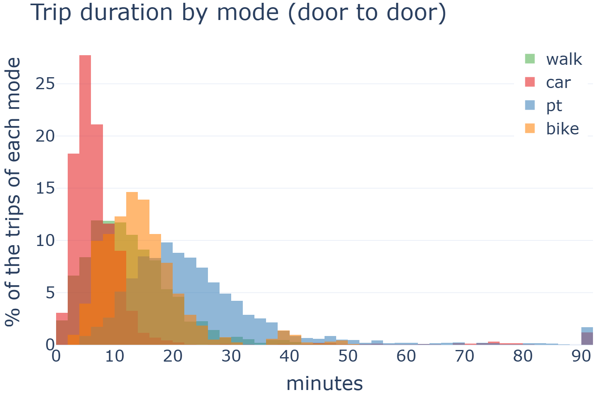
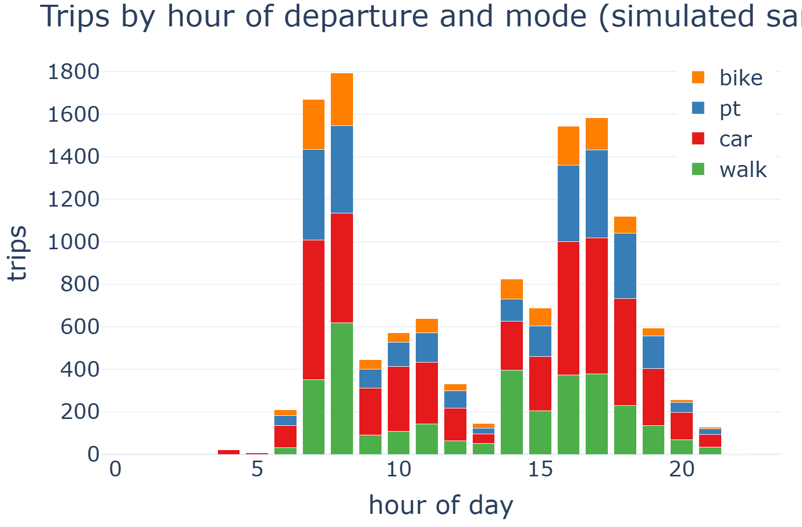
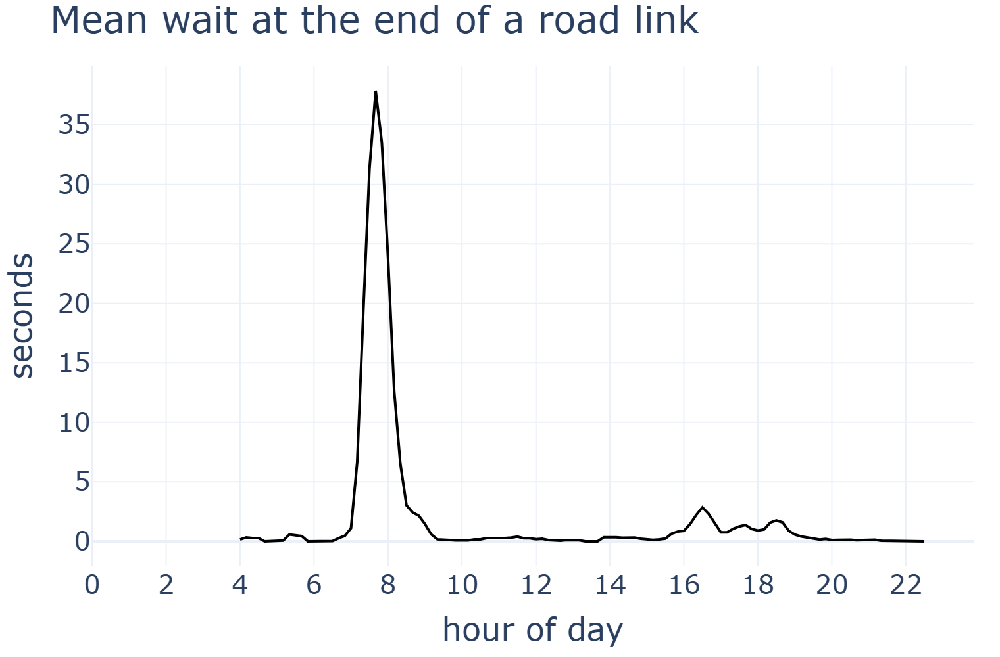
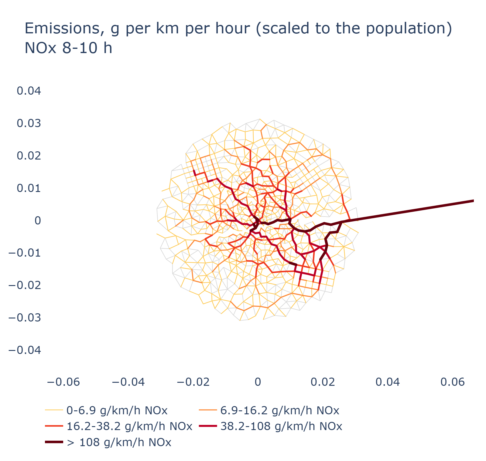

# MiMoS — Microscopic Mobility Simulator

MiMoS is an agent-based model of urban mobility. It assigns a micro-trajectory to every agent of a data-driven synthetic population, and simulates three modes:
- **public transport**: urban and regional buses, trains and rental bikes, with per-vehicle occupancy;
- **private car**: an event-driven queue micro-simulation with safety gaps, link storage and road-hierarchy priority at intersections;
- **bicycle**.

Agents iterate routing → mode choice → simulation → memory until they reach a stochastic user equilibrium. The model was introduced in Chapter 7 of a PhD thesis, *"Micro-Mobility Model & Simulator (MiMoS)"* (see [Reference](#reference)). How the model works: [docs/model.md](docs/model.md). The input files: [docs/input_format.md](docs/input_format.md).

> **Version 0.1.0 (November 2026)**: first public version of research software under active development. What works now and what is planned: [Roadmap](#roadmap).

## What MiMoS calculates: a demo

Everything below comes from a made-up example town (`uv run mimos demo --video`; no real data): an old core with irregular streets, grid suburbs, a ring road, radial arterials, a river with bridges, and bus lines that follow the roads. One run simulates every agent's day: who goes where, by which mode, on which road and bus, how long it takes, and what the traffic emits.



*The morning peak, 6:30–9:30. Left: cars (orange), bikes (green) and buses coloured by occupancy. Right: NOx emissions per road. Full video: [demo_side_by_side.mp4](docs/gallery/demo_side_by_side.mp4).*

<table>
<tr>
<td width="50%"><br><b>How long trips take.</b> Door-to-door durations of every trip, by mode.</td>
<td width="50%"><br><b>When people travel, and how.</b> Trips by hour of departure and mode.</td>
</tr>
<tr>
<td width="50%"><br><b>Congestion through the day.</b> Mean wait at the end of a road link: queues form at the morning peak.</td>
<td width="50%"><br><b>Where the traffic emits.</b> NOx per road during the morning peak.</td>
</tr>
</table>

The full interactive report (hour-by-hour maps, relaxation, boardings, emissions) is [docs/gallery/report.html](docs/gallery/report.html). Download it and open it in a browser, or view it online at <https://jeslop013.github.io/MiMoS/gallery/report.html>.

## Try it without any data

MiMoS can generate a made-up example town (irregular streets, a ring road, a river with bridges, bus lines on the roads, a population with daily agendas) and run it:

```
git clone https://github.com/jeslop013/MiMoS.git && cd MiMoS
uv sync                       # builds the C++ core (first time ~2 min; needs a C++ compiler, see Setup)
uv run mimos demo --video     # generate the town, run 10 iterations, emissions, report and a peak-hour video (~1 min)
```

Then open `examples/town/run/report/report.html` in a browser, and `examples/town/run/videos/vehicles.mp4`.

Options of `mimos demo` (and of `mimos example`, which only writes the town's data and `config.toml`):

| Option | Default | Meaning |
|---|---|---|
| `--agents N` | 5000 | simulated agents |
| `--scale S` | 0.1 | sample share they represent: 0.1 = a town of 10 x N inhabitants, roads and buses scaled to 10% (as MATSim); 1 = the agents are everybody |
| `--iterations K` | 10 | iterations of the run |
| `--seed S` | 0 | another seed gives another town of the same design (same seed, same town) |
| `--out DIR` | `examples/town` | where the data, config and `run/` go (git-ignored) |
| `--video` | off | also render a vehicles video of the morning peak (07:30-08:30) (`demo` only) |

```
uv run mimos demo --agents 20000 --iterations 20          # a bigger town (200,000 inhabitants), ~4 min
uv run mimos demo --seed 7 --out examples/town7           # another town, kept next to the first
uv run mimos example --out examples/mytown                # step by step: write the data,
uv run mimos run examples/mytown/config.toml              #   run it like any scenario (edit config.toml first if you like),
uv run mimos report examples/mytown/run --no-tiles        #   and build the report (made-up place: the town's own roads, no map tiles)
uv run mimos video examples/mytown/run --what vehicles --start 07:30 --end 08:30 --speed 30 --fps 60   # a slower, smoother clip
```

What the town contains, how it is used in the tests, and other ways to get example data: [docs/examples.md](docs/examples.md).

## What is in this repository

The repository is the **MiMoS tool**: everything generic that a study needs to go from ready inputs to results. Data, configurations and results of a particular study stay outside the repository (see *Workspace* below).

| Path | Contents |
|---|---|
| `cpp/` | C++17 core: `include/mimos/*.hpp`, `src/*.cpp` (one file per model stage), `bindings.cpp` (pybind11), `main.cpp` (stand-alone runner) |
| `src/mimos/` | Python package. Run: `config.py` (TOML), `model.py` (iteration loop), `progress.py`, `cli.py`. Results: `analysis.py` (per-trip results, iteration summary), `networks.py` (input readers). Post-processing: `emissions.py`, `calibration.py` (`mimos calibrate`) |
| `src/mimos/viz/` | Visualisation (extra `viz`): `report.py` (HTML report, PNG export), `video.py` (MP4 videos) |
| `src/mimos/scenarios/` | Generated example scenarios (`mimos example`, `mimos demo`): the synthetic town, no data needed |
| `src/mimos/data/` | Package data: EEA emission factors and an example vehicle fleet, with their sources |
| `tests/` | pytest suite: invariants, toy scenarios, example town, report; `tests/fixtures/` small fixtures |
| `docs/` | Model description, input format, examples, roadmap, demo gallery |

Inside the package, dependencies point one way: running a simulation needs only NumPy; analysis and emissions read what a run wrote; `viz` (plotly, matplotlib) is optional.

## Workspace

Data and results do not go into the repository. A suggested layout, with the repository next to its inputs and studies:

```
workspace/
  mimos/                       this repository: the tool
  inputs/<scenario>/           ready-to-use inputs of a scenario = a config's data_dir
    net_files/ pop_files/      networks, population, access candidates (format: docs/input_format.md)
    fleet.csv                  optional vehicle fleet for emissions
  <study>/                     one folder per study
    configs/                   run configurations (+ targets/ for calibration)
    runs/<run>/                one folder per run: raw outputs at the top level (config.toml, iterations.csv, trips.csv,
                               drive_links.npz, exec_*.csv, log.txt, ...) and the products: emissions/, report/, videos/
```

- **Inputs** must be in the MiMoS format, described file by file in [docs/input_format.md](docs/input_format.md). Preparing them from raw sources happens before MiMoS; importers for standard sources (OpenStreetMap, GTFS) are planned (see the [Roadmap](#roadmap)). The example town (`mimos example`) writes a complete scenario in this format.
- **Runs** go to `run_dir` in the config (relative to the config file) or `--run-dir`. `mimos emissions`, `mimos report` and `mimos video` take the run folder and write into it.

## Setup

1. Install [uv](https://docs.astral.sh/uv/).
2. Install a C++17 compiler (one time per machine):
   - **Windows**: Visual Studio 2022 Build Tools with the *Desktop development with C++* workload:
     `winget install Microsoft.VisualStudio.2022.BuildTools --override "--quiet --wait --add Microsoft.VisualStudio.Workload.VCTools --includeRecommended"`
   - **macOS**: `xcode-select --install`
   - **Linux**: `g++` (for example the `build-essential` package)
3. `uv sync`, which builds the C++ extension and installs the package.

   On Windows, clone into a short path outside the Temp folder (e.g. `C:/Users/<you>/MiMoS`): very long paths exceed the 260-character limit of the compiler tools, and the build then fails in CMake's compiler check.

## Running the model

Any scenario is run from its configuration file; the commands are the same for the example town and a real city. From the repository:

```
uv run mimos run <config.toml>                               # run; outputs go to the config's run_dir
uv run mimos run <config.toml> --n-agents 1000 --iterations 3 --run-dir <folder>
uv run mimos run <config.toml> --legacy                      # the model version of the thesis
uv run mimos calibrate <config.toml> <targets.toml>          # fit the mode constants to a survey's modal split
uv run mimos emissions <run_dir>                             # hot exhaust emissions of a run
uv run mimos report <run_dir> [--targets <targets.toml>] --serve   # HTML report of a run
uv run mimos report <run_dir> --png                          # ... plus every figure as a 1920x1080 PNG (report/figures/)
uv run mimos video <run_dir>                                 # MP4 videos: cars, bikes and buses (coloured by occupancy), traffic and emissions
uv run mimos video <run_dir> --what vehicles --start 08:00 --end 08:30 --speed 30 --fps 60 --tag _peak_0800   # smooth peak clip (1 min)
```

From a study folder, the same commands with `uv run --project <path to mimos> mimos ...`, so that paths stay relative to the study. A progress bar shows the running stage, elapsed time and time left (`--no-progress` to hide it; never written to logs or pipes). `mimos emissions`, `mimos report` and `mimos video` only read the files a run has written, so they can be repeated on any finished run (different view, time window, speed, `--tag`) without simulating again.

### Viewing and sharing a report

The report is one HTML file with plotly.js inside, so its charts open anywhere without internet. The **maps with tiles** are different: Chrome and Edge leave them blank when the file is opened directly (double-click, `file://`), because the map library inside plotly.js (MapLibre) stops its background worker on `file://` pages. They work when the file is served over http:

| Use | How |
|---|---|
| Look at it yourself | open it in VS Code's preview, or `uv run mimos report <run_dir> --serve` (builds the report, then serves it on localhost and opens the browser) |
| Send it to someone | build it with `--no-tiles --out <run_dir>/report/report_offline.html`: the maps draw the model's own road network as a grey backdrop instead of tiles, and open with a double-click anywhere; no street names |
| Slides | `--png` (1920x1080 at 2x, tiles included) or the MP4 videos |

### From Python

```python
from mimos import load_config, run
cfg = load_config("examples/town/config.toml", n_agents=1000)   # any config; this one from `mimos example`
model, report = run(cfg)            # report: timings + PublicStats/DriveStats per iteration
model.drive_scores, model.exec_drive, model.drive_trajectories   # results as NumPy/lists
```

The stages can also be called one by one (`model.load()`, `model.plan(it)`, `model.simulate_drive(it)`, ...); see `src/mimos/model.py`. Every parameter of a configuration is a field of `cpp/include/mimos/config.hpp` (defaults = the parameter values of the thesis); the town's generated `config.toml` is a commented example. Outputs go to `run_dir`: the CSV outputs of the core (see `cpp/src/io.cpp`), plus `config.toml` (the resolved configuration), `iterations.csv` (scores planned vs executed, mode switches, shares and traffic per iteration), `trips.csv` (every trip of the last iteration), `drive_links.npz` (every road link traversal), `log.txt` and `run_info.json`. `uv run mimos report <run_dir>` turns them into a self-contained `report.html` with plots and hour-by-hour animated maps (flow as % of capacity, occupancy, waits, emissions). Maps and videos look at the `[view]` of the run's config (centre and radius; `--center LAT LON --radius-km R` to change it). Road shapes for the maps come from the optional input `net_files/drive_network/link_geometry.npz` (docs/input_format.md). The visualisation libraries come with `uv sync`; outside the dev setup install the extra: `uv sync --extra viz` (or `pip install "mimos[viz]"`).

## Tests

```
uv run pytest                                              # config, synthetic scenarios, example town, report (~1 min)
```

The synthetic scenarios (`tests/scenario.py`) write complete tiny datasets, so the tests need no external data. They check that every agent finishes exactly once, that vehicles and roads get their full capacity back, and that cars are spaced by the safety time t_s.

## Developer notes

- `uv sync` / `uv run` rebuild the C++ extension automatically when files under `cpp/` change (`[tool.uv] cache-keys`). Planning runs on all cores (`threads` in the config); results do not depend on the number of threads.
- C++ only (no Python), for profiling: configure with CMake from a *Developer PowerShell for VS 2022*: `uv tool run cmake -S . -B build/cli -G Ninja` then `uv tool run cmake --build build/cli`, and run `build/cli/mimos_cli.exe <data_dir>/ <run_dir>/ [N] [log_level] [iterations]`.

## Roadmap

| Works now | Planned (details in [docs/roadmap.md](docs/roadmap.md)) |
|---|---|
| The full cycle: routing → mode choice → public transport, car and bicycle simulation → memory and learning, until a stochastic user equilibrium | Mode choice per trip and per tour; departure-time and route choice |
| C++17 core with a Python API and a command line; parallel route planning | Faster simulation for large cities |
| A made-up example town that needs no data: `uv run mimos demo` | Importers for OpenStreetMap and GTFS; a package on PyPI that needs no compiler |
| Hot exhaust emissions per link and hour; HTML reports; videos | Low-emission zones; more emission sources; scenario comparison |
| Calibration of the mode constants to a survey's modal split (`mimos calibrate`) | Public transport from GTFS timetables; traffic signals |
| `legacy_mode`: the model version of the thesis | Taxi and ride-hailing; traffic from outside the area |

Releases: [CHANGELOG.md](CHANGELOG.md).

## Reference

If you use MiMoS, cite the thesis in which the model was introduced (see also [CITATION.cff](CITATION.cff)):

> Moreno López, J. A. (2025). *An Agent-Based Journey in Social Systems Research: Motivations & Applications*. PhD thesis, Doctoral Programme in Physics, Universitat de les Illes Balears (IFISC). <https://ifisc.uib-csic.es/en/publications/an-agent-based-journey-in-social-systems-research/>

## Credits

MiMoS was conceived and designed by Jesús Arturo Moreno López and José J. Ramasco (IFISC, CSIC-UIB), within the PhD thesis above. Jesús Arturo Moreno López is the sole developer of the software.

The name: the thesis chapter is titled *"Micro-Mobility Model & Simulator (MiMoS)"*; this repository expands the acronym as "Microscopic Mobility Simulator".

## Acknowledgements

MiMoS was originally developed within the NEXT4MOB project (*Next Generation Tools for advanced Mobility solutions*) of the CSIC Interdisciplinary Thematic Platform PTI Mobility 2030 (<https://pti-mobility2030.csic.es/next4mob-project-next-generation-tools-for-advanced-mobility-solutions/>). It is a general-purpose tool: this repository does not contain the project's data or results.

## License

MiMoS is free software under the GNU General Public License, version 3 or later (GPL-3.0-or-later). See [LICENSE](LICENSE). The data files in `src/mimos/data/` keep the terms of their sources (see `src/mimos/data/SOURCES.md`).
